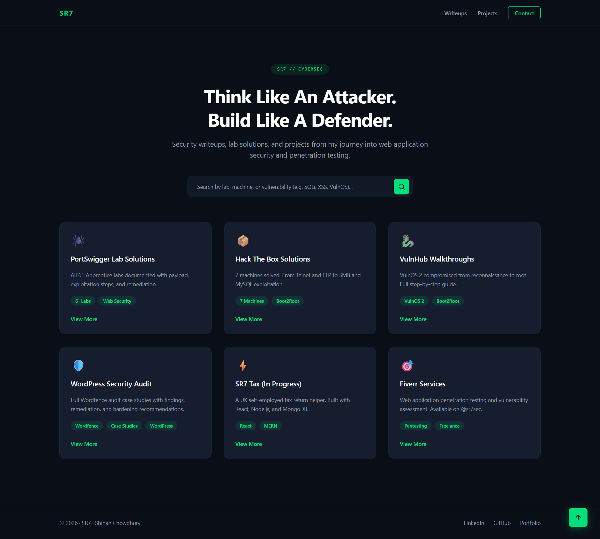
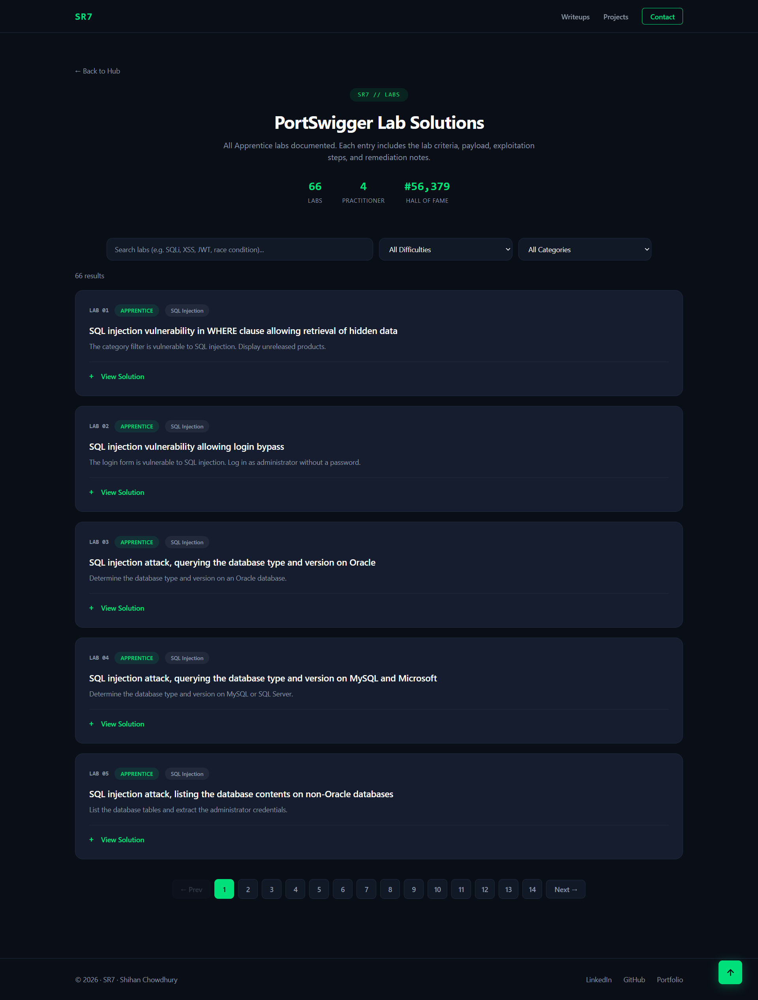
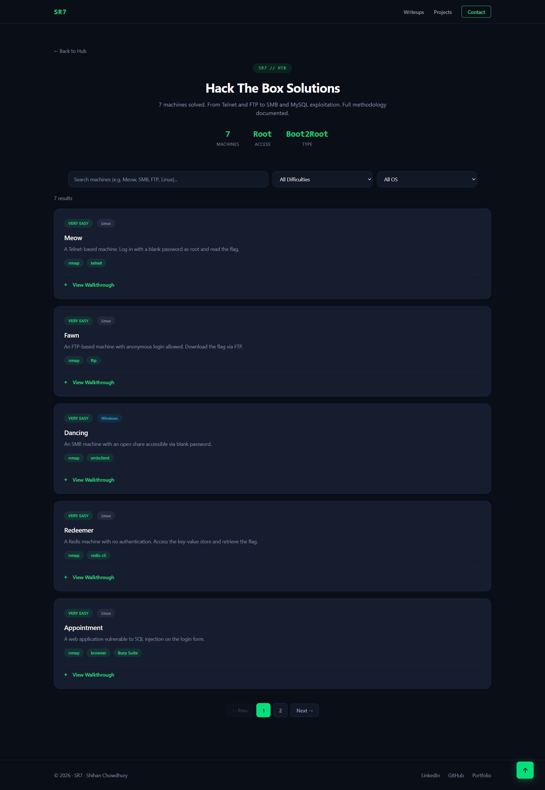
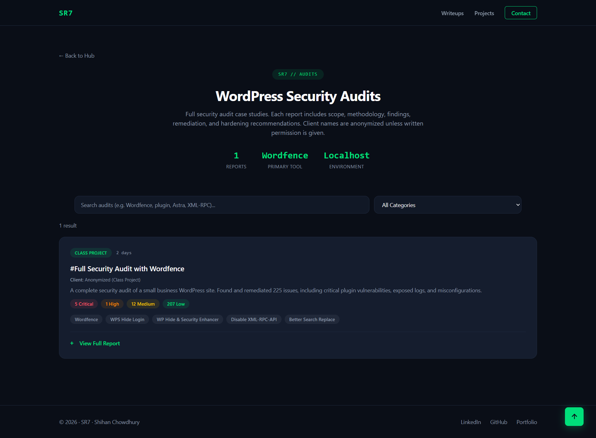
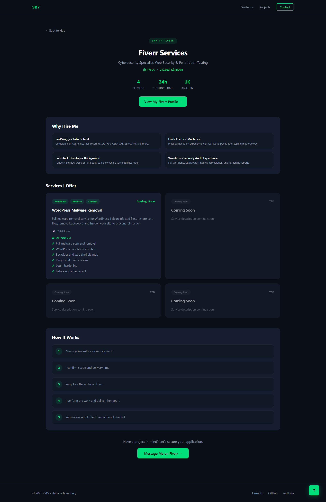
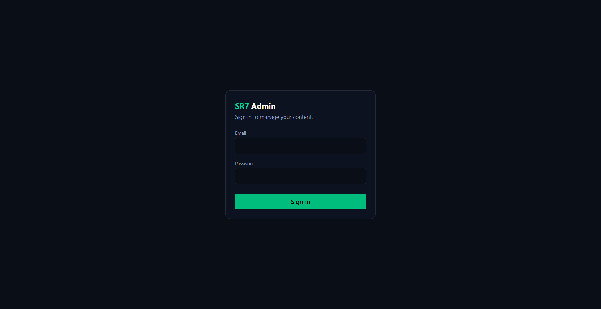
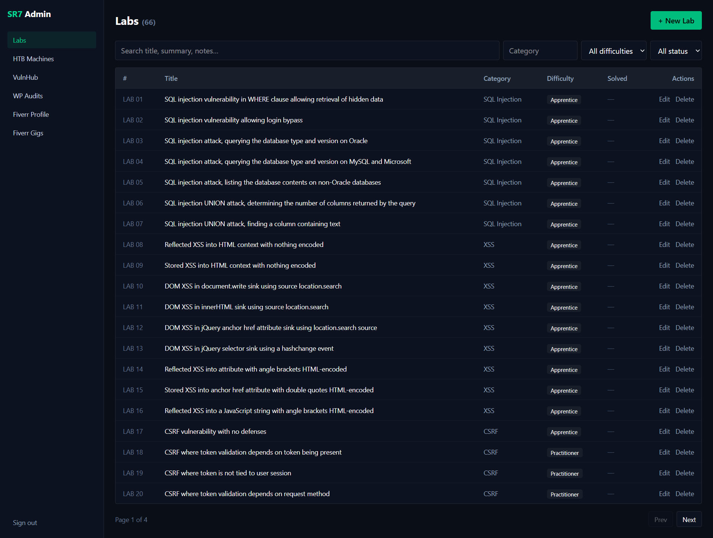

# SR7 Hub — Frontend

**SR7 Hub** is a personal portfolio and content platform by Shihan Chowdhury, showcasing web security writeups, hands-on lab walkthroughs, WordPress security audits, and freelance services.

Built with React and Vite, the frontend provides a searchable interface for technical content and an admin panel for managing published material through a separate REST API.

**Live Website:** https://sr7-hub.vercel.app  
**Admin Login:** https://sr7-hub.vercel.app/admin/login  
**Backend Repository:** https://github.com/SR-Chowdhury/sr7-hub-backend  
**Backend Health Check:** https://sr7-hub-backend.onrender.com/api/health

## Table of Contents

- [Features](#features)
- [Screenshots](#screenshots)
- [Technology Stack](#technology-stack)
- [Architecture](#architecture)
- [Application Routes](#application-routes)
- [Project Structure](#project-structure)
- [Getting Started](#getting-started)
- [Deployment](#deployment)
- [Security and Responsible Use](#security-and-responsible-use)
- [Author](#author)

## Features

- **PortSwigger Web Security Academy:** browse documented lab solutions and technical notes.
- **Hack The Box:** explore machine writeups and practical security exercises.
- **VulnHub:** follow walkthroughs covering reconnaissance, enumeration, exploitation, and privilege escalation in lab environments.
- **WordPress Security Audits:** review structured audit reports, findings, and remediation recommendations.
- **Fiverr Services:** view freelance service and profile information.
- **Search and Filtering:** find relevant content using available search and filtering controls.
- **Expandable Content:** navigate long technical solutions and walkthroughs without overwhelming the page.
- **Admin Panel:** manage labs, machines, walkthroughs, audits, gigs, and profile content.

## Screenshots

### Public Pages

<table>
  <tr>
    <td width="50%"><strong>Homepage</strong><br/></td>
    <td width="50%"><strong>PortSwigger Labs</strong><br/></td>
  </tr>
  <tr>
    <td width="50%"><strong>Hack The Box Machines</strong><br/></td>
    <td width="50%"><strong>VulnHub Walkthroughs</strong><br/></td>
  </tr>
  <tr>
    <td width="50%"><strong>WordPress Audits</strong><br/></td>
    <td width="50%"><strong>Fiverr Services</strong><br/></td>
  </tr>
</table>

### Admin Panel

<table>
  <tr>
    <td width="50%"><strong>Admin Login</strong><br/></td>
    <td width="50%"><strong>Labs Management</strong><br/></td>
  </tr>
</table>

## Technology Stack

| Technology | Purpose |
|---|---|
| React 19 | User interface |
| Vite | Development server and build tooling |
| React Router v7 | Client-side routing |
| Tailwind CSS v4 | Styling |
| Fetch API | HTTP requests to the backend |
| Vercel | Frontend deployment |

## Architecture

The frontend and backend are maintained in separate repositories and deployed independently.

```text
Browser
   |
   v
React + Vite Frontend
        |
        | HTTP / REST API
        v
Express Backend API
        |
        v
MongoDB
```

- **Frontend:** renders public pages, search interfaces, technical content, and the admin interface.
- **Backend:** handles API requests, authentication, authorization, and database operations.
- **Database:** stores application content and related records.

The frontend communicates with the backend through the `VITE_API_URL` environment variable. In production, this points to:

```text
https://sr7-hub-backend.onrender.com/api
```

**Security note:** client-side route protection improves the user experience but is not a security boundary. The backend must independently enforce authentication and authorization for protected operations.

## Application Routes

### Public Routes

| Route | Description |
|---|---|
| `/` | Homepage |
| `/portswigger` | PortSwigger lab solutions |
| `/htb` | Hack The Box machines |
| `/vulnhub` | VulnHub walkthroughs |
| `/wordpress-audit` | WordPress audit reports |
| `/fiverr` | Freelance services and profile |

### Admin Routes

| Route | Purpose |
|---|---|
| `/admin/login` | Admin login |
| `/admin/labs` | Manage PortSwigger labs |
| `/admin/machines` | Manage Hack The Box machines |
| `/admin/walkthroughs` | Manage VulnHub walkthroughs |
| `/admin/audits` | Manage WordPress audits |
| `/admin/gigs` | Manage freelance service listings |
| `/admin/profile` | Manage Fiverr profile information |

> The admin panel requires a user account in the backend database, created via the backend's `create:admin` script. There is no public signup.

Access to administrative operations must be enforced by the backend, regardless of frontend route visibility.

## Project Structure

```text
src/
├── admin/            # Admin interface and route protection
├── assets/           # Images, icons, and other assets
├── components/       # Reusable UI components
├── data/             # Legacy static data retained for reference
├── lib/              # API client and resource hooks
├── pages/            # Public page components
├── utils/            # Shared utilities
├── App.jsx           # Application routes and layout
└── main.jsx          # Application entry point
```

## Getting Started

### Prerequisites

- **Node.js 20+** (tested on Node.js 22.x)
- npm
- A running backend API, either locally or remotely

### 1. Clone the repository

```bash
git clone https://github.com/SR-Chowdhury/sr7-hub.git
cd sr7-hub
```

### 2. Install dependencies

```bash
npm install
```

### 3. Configure environment variables

Create a `.env` file in the project root:

```dotenv
VITE_API_URL=http://localhost:5000/api
```

For production, set `VITE_API_URL` in the Vercel project settings to the deployed backend API URL.

> **Security warning:** Vite variables prefixed with `VITE_` are exposed to client-side code. Never store database credentials, JWT secrets, private API keys, or other secrets in them.

### 4. Start the development server

```bash
npm run dev
```

Open the local URL displayed by Vite, normally `http://localhost:5173`.

The frontend requires a reachable backend API for dynamic content and administrative operations. Follow the backend repository's README for backend setup and database configuration.

### 5. Build for production

```bash
npm run build
```

The production build is generated in `dist/`.

To preview the production build locally:

```bash
npm run preview
```

### Available Scripts

| Command | Description |
|---|---|
| `npm run dev` | Start dev server on http://localhost:5173 |
| `npm run build` | Production build → `dist/` |
| `npm run preview` | Preview production build locally |
| `npm run lint` | Run ESLint |

## Deployment

The frontend is deployed on **Vercel**, separately from the backend API.

Deployment configuration includes:

- `VITE_API_URL` pointing to the intended backend API.
- Backend CORS configuration allowing the deployed frontend origin.
- SPA rewrite rules to support direct navigation and page refreshes on client-side routes.

The repository's `vercel.json` configures the SPA rewrite:

```json
{
  "rewrites": [
    { "source": "/(.*)", "destination": "/index.html" }
  ]
}
```

This ensures routes such as `/admin/login` work on direct navigation and page refresh.

## Related Repository

**SR7 Hub Backend:** https://github.com/SR-Chowdhury/sr7-hub-backend

The backend repository contains the server-side API and its implementation details. Refer to its README for backend installation, environment variables, API configuration, and deployment instructions.

## Security and Responsible Use

This portfolio documents educational security work and technical projects. Security testing should only be performed against systems you own or have explicit authorization to assess.

Public writeups and audit reports should contain only information that is appropriate to disclose. Do not publish credentials, confidential client information, or private security findings without authorization.

Clearly distinguish educational lab work, personal projects, simulated audits, and authorized client engagements.

## License

Personal portfolio project. Source code available for reference. Content (writeups, walkthroughs, audits) © Shihan Chowdhury.

## Author

**Shihan Chowdhury (SR7)**

- Portfolio: https://sr7-hub.vercel.app
- GitHub: https://github.com/SR-Chowdhury
